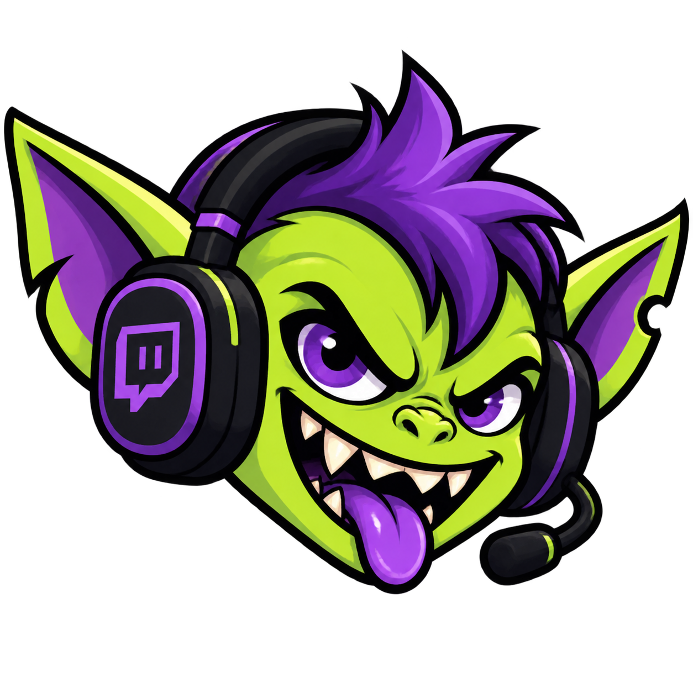

<div align="center">
  
  <h1>StreamGremlin</h1>
  <p><strong>Self-Hosted Twitch Chat, Channel Points, OBS Overlay & Gaming-PC Input Chaos Engine</strong></p>
  <p>
    <a href="LICENSE"></a>
    
    
    
  </p>
</div>

---

## Overview

**StreamGremlin** is an ultra-low-latency, database-free interactive stream chaos engine designed for Twitch streamers and their communities. Viewers and moderators can trigger audio-visual overlays in OBS, neural Text-to-Speech (TTS), interactive minigames, Smart-Home lighting effects, n8n workflows, and real-time keyboard/mouse input trolls on the streamer's Gaming PC.

### Core Highlights
- **Zero Database (`config/config.yaml`)**: Everything is stored in a single human-readable YAML file with live hot-reloading.
- **Rebuild-Safe Secrets & Sounds**:
  - `.env` is automatically re-encrypted to `.env.age` using the public `age` key (`keys/age-public-key.txt`) whenever Twitch tokens or settings change in the Web UI.
  - Custom audio files uploaded via the Web UI are saved directly into `sounds/` and tracked in Git (with 6 synthesized CC0 default sounds included out of the box).
- **Industrial Broadcast Cockpit UI (`Anti-AI-UI`)**: High-density tactical interface with instant trigger matrix, simulator bar, live telemetry log, and prominent global `PANIC! STOP ALL` killswitch.
- **100% Anti-Cheat-Safe Windows Companion Agent (`StreamGremlin.exe`)**: Pure userland keyboard/mouse synthesis (`pynput` + Win32 `SystemParametersInfoW`). Zero memory reading/writing, zero DLL injection, zero process scanning. Includes an emergency **Hardware Panic Switch (`ESC` 3x within 1.5s)**.

---

## Architecture

```
+------------------------+         EventSub WebSocket          +-----------------------------------+
|      Twitch Cloud      | <---------------------------------- |         StreamGremlin Hub         |
|  Chat / Channel Points |                                     |     FastAPI :4736 (Docker)        |
|  Subs / Bits / Raids   |                                     |  - config/config.yaml (Hot-Reload)|
+------------------------+                                     |  - sounds/ (CC0 + Custom Uploads) |
                                                               |  - Edge-TTS Neural Voice Synth    |
+------------------------+         Bidirectional HTTP          |  - .env.age Auto-Encryption       |
|  n8n & Home Assistant  | <---------------------------------> +-----------------------------------+
|  Webhooks & RGB Lights |                                        ^              ^              ^
+------------------------+                                        | WSS          | WSS          | HTTPS
                                                                  v              v              v
                                                       +---------------+  +-------------+  +--------------+
                                                       | OBS Overlay   |  | Gaming PC   |  | Web Cockpit  |
                                                       | 1920x1080     |  | Agent (.exe)|  | Admin /      |
                                                       | /overlay      |  | Userland    |  | Streamer /   |
                                                       | Physics/FX    |  | Input Hooks |  | Mod Roles    |
                                                       +---------------+  +-------------+  +--------------+
```

---

## 3-Tier Role-Based Access Control (Password Auth)

StreamGremlin uses a password-only 3-role hierarchy (`bcrypt` hashes stored in `config/config.yaml`, `HttpOnly` session cookies):

| Role | Capabilities | Password Management |
| :--- | :--- | :--- |
| **`admin`** | Full system configuration, Twitch OAuth, Smart Home, n8n, Security settings, Trigger Matrix, Live Deck. | Can change **Admin**, **Streamer**, and **Mod** passwords + configure Streamer & Mod permissions. |
| **`streamer`** | Trigger Matrix, Sound uploads, Cooldowns, Twitch OAuth connection, Live Deck. | Can change **own (Streamer)** password and **Mod** password + configure Mod permissions. |
| **`mod`** | Live-Deck cockpit, Global **PANIC!** button, and permitted Test/Instant Triggers. | Cannot change any passwords. |

### Emergency Admin Password Reset (CLI)
If the Admin password is lost, reset it directly inside the container:

```bash
docker exec -it streamgremlin python -m src.hub.cli reset-password
```

---

## Quickstart (Docker Compose)

1. **Generate `.env` and encrypted `.env.age`**:
   ```bash
   bash generate-env.sh
   ```
2. **Start the Hub container**:
   ```bash
   docker compose up -d
   ```
3. **Open the Broadcast Cockpit**:
   - Local: `http://localhost:4736`
   - Production (Jannik-Cloud): `https://streamgremlin.orfel.de` (aliases: `https://sg.orfel.de`, `https://gremlin.orfel.de`)

---

## OBS Studio Setup (`/overlay`)

1. In OBS Studio, add a new **Browser Source**.
2. Set the URL to:
   ```text
   https://streamgremlin.orfel.de/overlay?token=<YOUR_OVERLAY_TOKEN>
   ```
   *(You can copy the exact one-click URL from the top bar of the StreamGremlin Dashboard).*
3. Set Width to **`1920`** and Height to **`1080`**.
4. Check **"Control audio via OBS"** if you want separate audio routing in the OBS mixer, and check **"Refresh browser when scene becomes active"**.

### Available Overlay & Audio Actions
- **Audio & TTS**: `sound` (ordered queue, random pools, per-trigger volume 0–200%), `tts` (Microsoft Azure Neural `edge-tts`, e.g., `de-DE-ConradNeural`, `de-DE-KatjaNeural`).
- **Visual Shaders & FX**: `flashbang`, `screen_shake`, `screen_tilt`, `drunk_mode`, `screen_glitch`, `fake_bsod`, `blackout`, `pixelate`, `invert_colors`, `tunnel_vision`, `rave_mode`, `censored_bar`, `mirror_mode`, `fake_alert`, `gif_jumpscare`.
- **Particles**: `confetti`, `matrix_rain`, and **2D Physics Emote Rain** (automatically spawns bouncing Twitch & BTTV emotes from chat messages; caps at 50 active sprites and fades after 15s).
- **Minigames**:
  - `wheel_of_fortune`: Spins an animated wheel on stream and automatically fires the winning trigger.
  - `timebomb`: Starts a ticking countdown bomb on the overlay; chat users type `!cut red`, `!cut blue`, or `!cut green` to defuse before detonation.

---

## Twitch OAuth & EventSub Setup

1. Create an application in the [Twitch Developer Console](https://dev.twitch.tv/console/apps).
2. Add the OAuth Redirect URI:
   ```text
   https://streamgremlin.orfel.de/api/twitch/callback
   ```
3. Enter your `TWITCH_CLIENT_ID`, `TWITCH_CLIENT_SECRET`, and `TWITCH_BROADCASTER_NAME` in the **Twitch & OAuth** tab of the Dashboard.
4. Click **Connect with Twitch OAuth**. StreamGremlin automatically subscribes to EventSub WebSocket events (Public Chat, Channel Points, Bits, Subs, Raids, Follows, Hype Train) and syncs custom Channel Point rewards.
5. **Chat Prefix & Word Matching**:
   - The command prefix defaults to `!` (configurable in the UI; `/` is strictly blocked as it is reserved by Twitch).
   - Every chat keyword trigger supports toggling between **`word` boundary matching** (`\bwort\b`, default) and **`substring` matching** (`wort` anywhere in text), always case-insensitive.

---

## Windows Companion Agent (`StreamGremlin.exe`)

The Companion Agent runs in the Windows System Tray on the Gaming PC and connects outbound to the Hub via WebSocket.

### Building `StreamGremlin.exe`
```powershell
pip install -r src/agent/requirements-agent.txt
python src/agent/build_exe.py
```
The standalone executable is created at `dist/StreamGremlin.exe`.

### Running the Agent
Create an `agent_config.json` next to `StreamGremlin.exe` (or pass `--url` and `--token`):
```json
{
  "hub_url": "https://streamgremlin.orfel.de",
  "token": "YOUR_AGENT_TOKEN"
}
```
- **System Tray Indicator**: Green dot = Connected to Hub, Red dot = Disconnected (auto-reconnecting silently). Right-click for **Status**, **PANIC! Reset Inputs**, or **Beenden**.
- **Hardware Panic Hotkey**: Press **`ESC` 3 times within 1.5 seconds** at any time in-game to immediately terminate all active input trolls and clear the OBS overlay.
- **Available Input Trolls**: `invert_keys` (WASD swap), `jam_key` (autorun hold), `disable_key`, `weapon_roulette`, `reload_addiction`, `jump_frenzy`, `flashlight_rave`, `crouch_spam`, `mouse_sensitivity` (Snail / Quake Pro), `mouse_invert`.

---

## n8n & Smart Home (Home Assistant) Integration

### 1. Inbound Webhook (Trigger StreamGremlin from n8n / StreamDeck)
Send a `POST` request to `/api/webhook/trigger` with header `X-Webhook-Secret: <WEBHOOK_SECRET>`:

```bash
curl -X POST https://streamgremlin.orfel.de/api/webhook/trigger \
  -H "Content-Type: application/json" \
  -H "X-Webhook-Secret: YOUR_WEBHOOK_SECRET" \
  -d '{
    "trigger_id": "chat_flashbang",
    "user": "n8n_Automation",
    "bypass_cooldown": true
  }'
```

### 2. Outbound Webhook (StreamGremlin -> n8n)
Configure `n8n_webhook_url` in the Dashboard. Every executed trigger (or dedicated `webhook` action) sends a structured JSON payload (`event`, `trigger_id`, `trigger_name`, `user`, `text`, `timestamp`) to n8n.

### 3. Smart Home Light Control (`smart_home` Action)
When viewers redeem Channel Points (e.g., *"Red Alert Light for 1000 Points"*), StreamGremlin calls the Home Assistant REST API (`HA_URL` + `HA_TOKEN`) to set the target light entity to the specified RGB color and brightness, then **automatically restores the previous light state** after `duration` seconds.

---

## License

Dedicated to the public domain under **[CC0 1.0 Universal](LICENSE)**.
